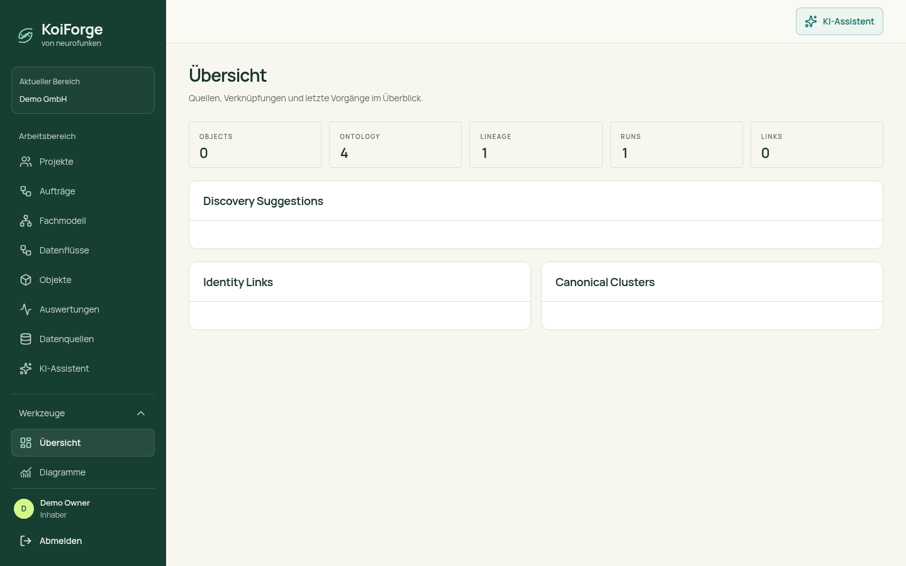
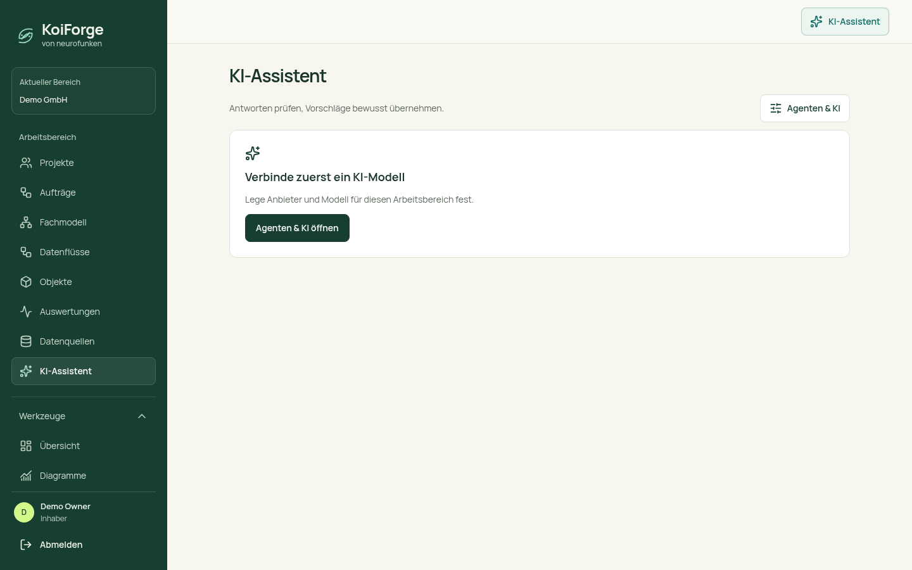
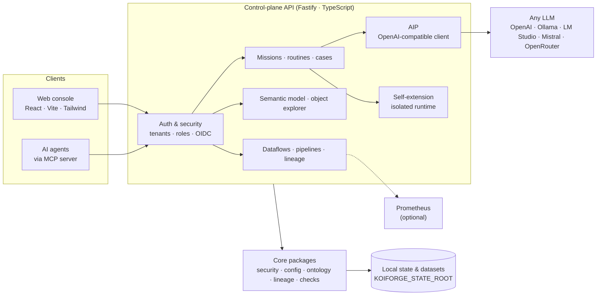

<p align="center">
  
</p>

<h1 align="center">KoiForge</h1>

<p align="center"><strong>Turn operational questions into verified, reproducible answers from your own data.</strong></p>

<p align="center">
  <a href="LICENSE"></a>
  
  
  
  <a href="CONTRIBUTING.md"></a>
</p>

<p align="center">
  <a href="https://neurofunken.de"></a><br>
  <sub>a neurofunken project</sub>
</p>

---

KoiForge is an open-source platform for **data-centric business applications**. It connects operational
questions — *"Which orders are overdue?"*, *"Is this source still fresh?"*, *"Which suppliers are unmapped?"* —
with data sources, confirmed checking rules and traceable results. Findings become cases with owners and history;
repeatable checks become routines; every number can be traced back to a source revision.

> **Status:** early open-source release (v0.1). Core workflows (data sources, semantic model, missions,
> routines, cases, object explorer) are implemented; APIs may still change.

<p align="center">
  
  
</p>

## Contents

- [Features](#features) · [Architecture](#architecture) · [Quick start](#quick-start) · [Configuration](#configuration)
- [AI providers](#ai-providers-vendor-neutral) · [MCP server](#mcp-server) · [Agent skill](#agent-skill)
- [Documentation](#documentation) · [Contributing](#contributing) · [License](#license) · [Deutsch](#kurzfassung-deutsch)

## Features

- **Data sources** — upload or connect CSV and other sources, preview, search, filter and save views.
- **Semantic model** — give sources confirmed business names, ID fields and relationships; detect missing or
  ambiguous mappings between object sets.
- **Missions** — ask a business question against a dataset; KoiForge plans a check (freshness, completeness,
  duplicate keys, relationships, overdue orders) that runs only after explicit confirmation.
- **Routines** — save completed missions and re-run them on new data revisions with a before/after comparison of
  findings (new, persisting, resolved).
- **Cases** — turn findings into clarification cases with ownership, closing notes and reopening — fully audited.
- **Object explorer** — stable object addresses, forward/backward relationships, revisions and provenance.
- **Dataflows & pipelines** — dependency-aware dataflows, lineage events and runs.
- **Self-extension** — missing analysis capabilities can be generated, tested in an isolated Linux runtime and
  reused.
- **Security** — tenants, roles and permissions, local accounts or OIDC single sign-on, CSRF protection,
  config/secret registry.
- **Agent-ready** — vendor-neutral AI (any OpenAI-compatible endpoint), an MCP server (`mcp/`) and an Agent
  Skill (`skills/koiforge`).

## Architecture



More detail: [docs/ARCHITECTURE.md](docs/ARCHITECTURE.md).

## Quick start

```sh
# Requirements: Node.js 22+, pnpm 10 (corepack enable)
git clone <this-repo> koiforge && cd koiforge
pnpm install
pnpm build
pnpm dev:linux            # API on :3100, console on :5173
```

Open <http://127.0.0.1:5173>, create the first owner account (local setup is allowed on loopback in
development), and load the synthetic examples from *Datenquellen → Beispieldaten*. Kubernetes: `deploy/helm/`.

## Configuration

| Variable | Default | Description |
| --- | --- | --- |
| `HOST` / `PORT` | `0.0.0.0` / `3000` | API listen address (`pnpm dev:linux` uses `127.0.0.1:3100`, set via `KOIFORGE_API_PORT` / `KOIFORGE_WEB_PORT`) |
| `KOIFORGE_STATE_ROOT` | `./.koiforge` | Persistent state (accounts, models, missions, datasets) |
| `KOIFORGE_PUBLIC_ORIGIN` | `http://localhost:5173` | Console origin; must be HTTPS in production |
| `KOIFORGE_BOOTSTRAP_TOKEN` | – | Setup code (≥ 32 chars) required for first-owner setup in production |
| `KOIFORGE_OIDC_ISSUER`, `KOIFORGE_OIDC_CLIENT_ID`, `KOIFORGE_OIDC_LABEL`, `KOIFORGE_OIDC_ADMIN_ROLE` | – | Optional single sign-on |
| `KOIFORGE_AI_BASE_URLS` | – | Extra allowed AI base URLs (comma-separated, exact match) |
| `KOIFORGE_EXTENSION_BACKEND` | `api` | `codex` (local Codex CLI) or `api` (configured OpenAI-compatible endpoint) |
| `KOIFORGE_CODEX_MODEL`, `KOIFORGE_CODEX_REASONING_EFFORT` | `gpt-6-astra`, `xhigh` | Model settings for the Codex backend |
| `KOIFORGE_GENERATION_DISABLED` | – | `1` disables all generation (reuse verified capabilities only) |
| `KOIFORGE_PROMETHEUS_URL` | – | Optional monitoring source |

Full reference: [docs/CONFIGURATION.md](docs/CONFIGURATION.md).

## AI providers (vendor-neutral)

KoiForge talks to any **OpenAI-compatible** Chat Completions endpoint. Configure provider, base URL, model and an
optional API key in the console under *KI-Assistent → Agenten & KI*:

| Provider | Base URL | Example model | Allowlist |
| --- | --- | --- | --- |
| Ollama (local) | `http://localhost:11434/v1` | `llama3.2` | built-in (development) |
| LM Studio (local) | `http://localhost:1234/v1` | loaded model | `KOIFORGE_AI_BASE_URLS` |
| OpenAI | `https://api.openai.com/v1` | `gpt-4o-mini` | built-in |
| Mistral | `https://api.mistral.ai/v1` | `mistral-small-latest` | `KOIFORGE_AI_BASE_URLS` |
| OpenRouter | `https://openrouter.ai/api/v1` | `anthropic/claude-sonnet-4` | `KOIFORGE_AI_BASE_URLS` |
| Anthropic | `https://api.anthropic.com/v1/` (OpenAI SDK compatibility) | `claude-sonnet-4-6` | `KOIFORGE_AI_BASE_URLS` |

Mission planning and self-extension use the configured **OpenAI-compatible AIP endpoint** by default (`api`).
Set `KOIFORGE_EXTENSION_BACKEND=codex` to opt into the local **Codex CLI**
(`gpt-6-astra` / `xhigh` by default). Details: [docs/AI-PROVIDERS.md](docs/AI-PROVIDERS.md).

## MCP server

`mcp/` contains a dependency-free [Model Context Protocol](https://modelcontextprotocol.io) server (Node.js ≥ 20,
stdio transport) that exposes KoiForge's key operations to any MCP client — Claude, Codex, Cursor, LM Studio,
Grok Bot or your own agent running a local model.

### Tools

| Tool | Kind | Purpose |
| --- | --- | --- |
| `koiforge_health` | read | API health and version |
| `koiforge_session` | read | Current user, tenant and roles |
| `koiforge_list_projects` | read | Projects |
| `koiforge_list_datasets` | read | Registered datasets |
| `koiforge_get_dataset` | read | One dataset with schema |
| `koiforge_preview_dataset` | read | Preview rows (search, sort, limit) |
| `koiforge_get_object` | read | Business object with relationships and provenance |
| `koiforge_list_missions` | read | Missions |
| `koiforge_get_mission` | read | Mission with plan, results, evidence |
| `koiforge_list_cases` | read | Clarification cases |
| `koiforge_get_case` | read | One case with history |
| `koiforge_list_routines` | read | Saved routines |
| `koiforge_create_mission` | write | Ask a business question against a dataset |
| `koiforge_run_mission` | write | Run a mission (requires `confirmed: true`) |

Write tools are hidden when `KOIFORGE_READ_ONLY=true`. Errors from the API are returned as tool errors
(`isError: true`) with the HTTP status, never with credentials.

### Configuration

All settings come from environment variables — **no secrets are stored in this repository**.

| Variable | Example | Required | Description |
| --- | --- | --- | --- |
| `KOIFORGE_BASE_URL` | `http://127.0.0.1:3100` | yes | KoiForge control-plane API base URL |
| `KOIFORGE_SESSION_TOKEN` | `<session-token>` | one of | Value of the `koiforge_session` cookie |
| `KOIFORGE_EMAIL / KOIFORGE_PASSWORD` | `<user> / <password>` | one of | Log in at startup via `/api/auth/login` |
| `KOIFORGE_READ_ONLY` | `true` | no | Hide all write tools |

### Client setup

**Claude Desktop / Cursor / generic MCP JSON** (`claude_desktop_config.json`, `.cursor/mcp.json`, …):

```json
{
  "mcpServers": {
    "koiforge": {
      "command": "node",
      "args": ["/absolute/path/to/koiforge/mcp/src/server.mjs"],
      "env": {
        "KOIFORGE_BASE_URL": "http://127.0.0.1:3100",
        "KOIFORGE_EMAIL": "<user@example.org>",
        "KOIFORGE_PASSWORD": "<password>"
      }
    }
  }
}
```

**Claude Code:**

```sh
claude mcp add koiforge --env KOIFORGE_BASE_URL=http://127.0.0.1:3100 --env KOIFORGE_EMAIL=<user@example.org> --env KOIFORGE_PASSWORD=<password> -- node /absolute/path/to/koiforge/mcp/src/server.mjs
```

**OpenAI Codex CLI** (`~/.codex/config.toml`):

```toml
[mcp_servers.koiforge]
command = "node"
args = ["/absolute/path/to/koiforge/mcp/src/server.mjs"]
env = { KOIFORGE_BASE_URL = "http://127.0.0.1:3100", KOIFORGE_EMAIL = "<user@example.org>", KOIFORGE_PASSWORD = "<password>" }
```

**Run / test directly:**

```sh
cd mcp && npm test                       # unit tests against a mock API
KOIFORGE_BASE_URL=http://127.0.0.1:3100 node mcp/src/server.mjs   # speaks MCP on stdin/stdout
```

## Agent skill

[`skills/koiforge/SKILL.md`](skills/koiforge/SKILL.md) is an [Agent Skill](https://agentskills.io) (YAML frontmatter with
`name` + `description`, followed by step-by-step instructions). It teaches an agent the safe workflow on top of
the MCP tools: read schemas first, write drafts, resolve conflicts deliberately, and ask a human before anything
goes live.

- **Claude Code / Claude apps:** copy `skills/koiforge` to `~/.claude/skills/koiforge` (or `.claude/skills/` in a project).
- **Codex:** copy it to `~/.codex/skills/koiforge` (or reference it from `AGENTS.md`).
- **Grok Bot and other agents:** add the folder as a skill, or paste `SKILL.md` into the agent's instructions.
- **Local models (Ollama, LM Studio, …):** use `SKILL.md` as system prompt together with the MCP server.
## Documentation

| Document | Topic |
| --- | --- |
| [docs/ARCHITECTURE.md](docs/ARCHITECTURE.md) | Packages, services and data flow |
| [docs/CONFIGURATION.md](docs/CONFIGURATION.md) | Environment variables |
| [docs/AI-PROVIDERS.md](docs/AI-PROVIDERS.md) | AI setup and security model |
| [docs/MCP-AND-SKILLS.md](docs/MCP-AND-SKILLS.md) | MCP server and agent skill |
| [docs/adr/](docs/adr/) | Architecture decisions |
| [docs/README.de.md](docs/README.de.md) | Full German project documentation |

## Contributing

Contributions are welcome. Please read [CONTRIBUTING.md](CONTRIBUTING.md) and the
[Code of Conduct](CODE_OF_CONDUCT.md); report vulnerabilities privately per [SECURITY.md](SECURITY.md).
Note: a few isolation tests need `bubblewrap` and a systemd user session (Linux).

## License

[MIT](LICENSE) © 2026 Hanns Leonhard Osterbrink / neurofunken.

---

## Kurzfassung (Deutsch)

KoiForge ist eine quelloffene TypeScript-Plattform für datengetriebene Fachanwendungen: betriebliche Fragen
werden mit Datenquellen, bestätigten Prüfregeln und nachvollziehbaren Ergebnissen verbunden – mit Fachmodell,
Aufträgen, Routinen, Klärungsfällen und Objekt-Explorer. KI ist **anbieterneutral** über jede OpenAI-kompatible
Schnittstelle nutzbar (Ollama, LM Studio, Mistral, OpenRouter, OpenAI …). Ein **MCP-Server** und ein
**Agent Skill** machen KoiForge für Claude, Codex, Grok Bot oder lokale Modelle nutzbar. Schnellstart:
`pnpm install && pnpm build && pnpm dev:linux`. Ausführliche Doku: [docs/README.de.md](docs/README.de.md).

<p align="center"><sub>Built with care by <a href="https://neurofunken.de">neurofunken</a>.</sub></p>
