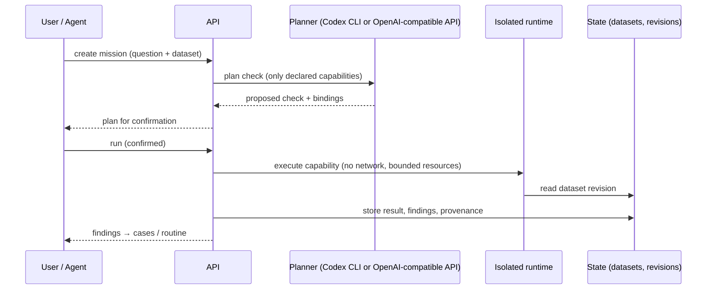

# KoiForge architecture

KoiForge is a pnpm/turbo TypeScript monorepo.

| Part | Path | Responsibility |
| --- | --- | --- |
| Control-plane API | `apps/control-plane-api` | Fastify API: auth & security, data sources, semantic model, missions, routines, cases, object explorer, dataflows, AIP, self-extension |
| Console | `apps/console` | React + Vite + Tailwind web UI |
| Core packages | `packages/*` | Shared contracts and logic (security, config/secret registry, ontology, lineage, checks, SDK) |
| Helm chart | `deploy/helm` | Kubernetes deployment |
| MCP server | `mcp/` | Model Context Protocol bridge for AI agents |
| Agent skill | `skills/koiforge` | Instructions for agents using the MCP server |

## Mission flow

## Principles

- **Nothing runs unconfirmed.** Plans are proposals; execution requires explicit confirmation.
- **Provenance everywhere.** Every result references dataset revision, rule and capability version.
- **Isolation.** Generated capabilities run in a bubblewrap/systemd-run sandbox on Linux without network access.
- **Server-side authorization.** Tenants, roles and permissions are enforced in the API; CSRF protection for
  cookie sessions (`x-koiforge-request: 1`).
- **Exact AI allowlist.** AI base URLs must match an allowlist exactly; credentials are never forwarded on
  redirects.

Architecture decisions: [adr/](adr/).
